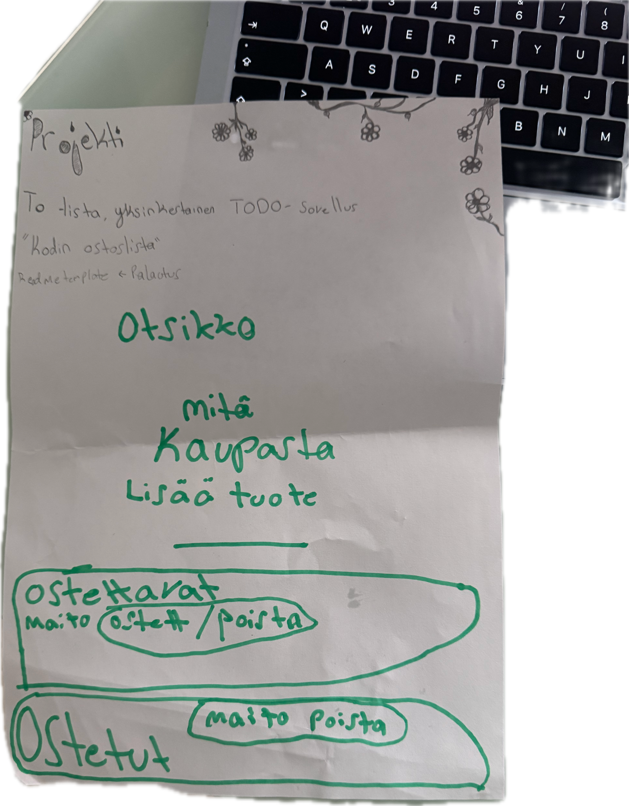
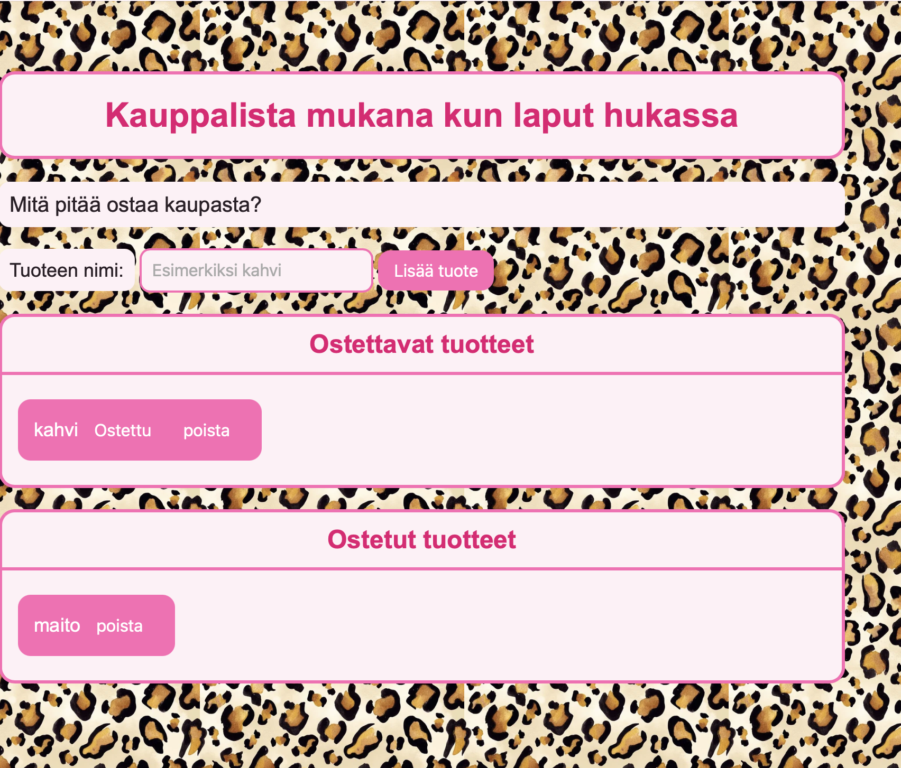

Kauppalista mukana kun laput hukassa
**Tekijä(t):** Nette Koskenniemi

## Projektisuunnitelma
Teen projektia yksin ja pyrin jaksoittamaan osioiden tekoa eri päiville. HTML, js ja css pyrin jakamaan eri päiville.

### Projektin idea

Kodin ostoslista sovelluksessa on kotiin tarvittaviaa ostoksia ja aina kun tuote loppuu käyttäjä siirtää sen ostoslistalle ja kun se on ostettu käyttäjä voi siirtää sen pois sieltä ns hoidettu listalle. Sovellus on hyvä niille jotka haluavat helpottaa arkea pitämällä kauppalistaa netissä.

### Suunnitellut toiminnot

- Toiminto 1 Tuote lisätään listaan. Käyttäjä lisää tuotteen listaan kirjoittamalla sen tekstikenttään ja painamalla lisää painiketta. 
- Toiminto 2 Tuote on ostettu osio. Kun käyttäjä on ostanut tuotteen tai ei tarvitse enään tuotetta hän voi merkitä sen ostetuksi ja tällöin se siirtyy ostettujen tuotteiden listalle.
- Toiminto 3 Tuotteen poistaminen ostoslistalta tai ostettujen tuotteiden listalta.
- Toiminto 4 Tietojen tallennus. Sovellus tallentaa tiedot vaikka selain suljetaan tai päivitetäään.
- Toiminto 5 Virheilmoitus. Tyhjää tuotetta ei voi lisätä sovellukseen

### Rautalankamalli / luonnos
kuva 

## Verkkolinkit

- **Julkaistu sovellus:** [Lisää tähän GitHub Pages -osoite](https://yourusername.github.io/your-repository/)
- **GitHub-repositorio:** [Lisää tähän repositorion osoite](https://github.com/yourusername/your-repository)
- **Projektin videoesittely:** [Lisää tähän videon osoite](https://example.com/)

## Tietoja sovelluksesta

Kauppalista mukana kun laput hukassa on verkkosovellus, joka auttaa käyttäjää pitämään kirjaa kodin ostoksista. Sovellukseen merkitään tuotteitä ja poistetaan listalta pois jos halutaan ne pois. Sovelluksen avulla ei tarvitse enään pitää mukana lappuja tai kumppanin kanssa eri listoja, jolloin niitä vaikea löytää. Samalla on mahdollista löytää jo lisätyt tuotteet.

Kuvaile lyhyesti sovelluksen tarkoitus ja tärkeimmät toiminnot.

## Teknologiat

- HTML – sivun rakenne
- CSS – ulkoasu ja asettelu
- JavaScript – toiminnallisuus, DOM-skriptaus ja lomakkeiden validointi
- DOM- skriptaus: Sivun sisällön muuttminen JavaScriptin avuin.
- localStorage – tietojen tallentaminen selaimeen, jos käytit sitä

## Sovelluksen käyttö

1.Avaa Kodin ostoslista -sovellus selaimessa.

2.Kirjoita ostettavan tuotteen nimi tekstikenttään.

3.Paina Lisää-painiketta, jolloin tuote ilmestyy ostoslistalle.

4.Kun olet ostanut tuotteen, paina Ostettu-painiketta.

5.Tuote siirtyy ostettujen tuotteiden listalle.

6.Voit myös poistaa tuotteita painamalla Poista-painiketta.

7. Päivitä sivu ja tarkista, säilyvätkö tiedot selaimessa, jos käytit localStoragea.

## Sovelluksen käynnistäminen paikallisesti

1. Kloonaa tai lataa tämä repositorio omalle koneellesi.
2. Avaa projektikansio.
3. Avaa `index.html` selaimessa.

## Kuvakaappaukset

## Tunnetut virheet / puutteet

yhdeksi toiminnoksi olisi voinut laittaa että ostoslistalta saa laitettua tuotteen takaisin ostettavien listalle.

Kerro, jos sovelluksessa on tunnettuja virheitä, puuttuvia toimintoja tai muita rajoituksia.
virheeksi sain 
Failed to load resource: the server responded
with a status of 404 (Not Found)
favicon.ico, mutta se ei ole iso virhe ja voi lähteä käyttämällä sovellusta.
Kohdassa problems ei ollut ongelmia, joten muutoin projektissa ei minun löytääkseni ole ongelmia.

## Oma arvio ja oppimisen reflektointi

Pohdi työtäsi ja oppimisprosessiasi.
Tajusin projektin aikana kuinka tärkeää on linkittää oikeast asiat yhteen. Linkittäminen ja niiden näkeminen verkkoversiossa reaalisti helpoittaa työntekemistä todella paljon. Myös kaikki linkitykset html kansioon on todella tärkeää ja että nimet ovat täysin oikein. Oli kiva oppia ja lisätä tietoa js toiminnasta, koska juuri se saa koodin toimimaan. Haastavaksi osottauitui oikean koodin kirjoitus. Minulla tuli niin paljon kirjotusvirheitä, joiden vuoksi koodi ei ttoiminut ollenkaan tai sekoitti koko sivua. On hassua kuinka yksi rivi uutta koodia voi saada jo täysin toimivan koodin sekaisin. Olisin lisännyt tetävään napin jolla saisi ostokset takaisin ostoslistalle jos minulla olisi ollut enemmän aikaa. HTML osaamiseni kasvoi pienellä määrällä lisä ymmärrystä, mutta koen saaneeni oppia JavastaScriptistä todella paljon ja kuinka tärkeä se on projektia tehdessä. Dom- skriptaus oli vaikeaa, mutta se oli kivan haastavaa. Ehkä epäselväksi jäi että jos olisin juuri halunnut lisätä toiminnon niin mihin sen olisin lisännyt. Tai pitääkö koodissa toimia tietyllä hierarkialla. Antaisin omasta suorituksestani 8/10

## Lähteet ja kiitokset

Listaa kaikki projektissa käyttämäsi lähteet, tutoriaalit, kuvat ja koodiesimerkit.

Jos käytit ChatGPT:tä, GitHub Copilotia tai muuta tekoälytyökalua, mainitse se tässä ja kerro lyhyesti, miten se tuki työskentelyäsi.

- [Lähteen tai tutoriaalin nimi](https://example.com/)
- [Kuvalähde]https://create.vista.com/fi/unlimited/stock-photos/635957224/stock-photo-watercolor-leopard-pattern-gold-hand-made-animal-skin-seamless/ 
- Käytetty tekoälytyökalu: ChatGPT (OpenAI)
  - Miten työkalua käytettiin: Käytin ChatGPTä apuna HTML-, CSS- ja JavaScript-koodin kirjoittamisessa, virheiden etsimisessä ja korjaamisessa sekä sovelluksen ulkoasun suunnittelussa. Sain myös apua DOM-skriptauksen ja localStorage-tallennuksen ymmärtämiseen.

  ## Lisenssi

Tämä projekti on lisensoitu MIT-lisenssillä.

Lisätietoa lisenssin lisäämisestä GitHub-projektiin:
https://docs.github.com/en/communities/setting-up-your-project-for-healthy-contributions/adding-a-license-to-a-repository